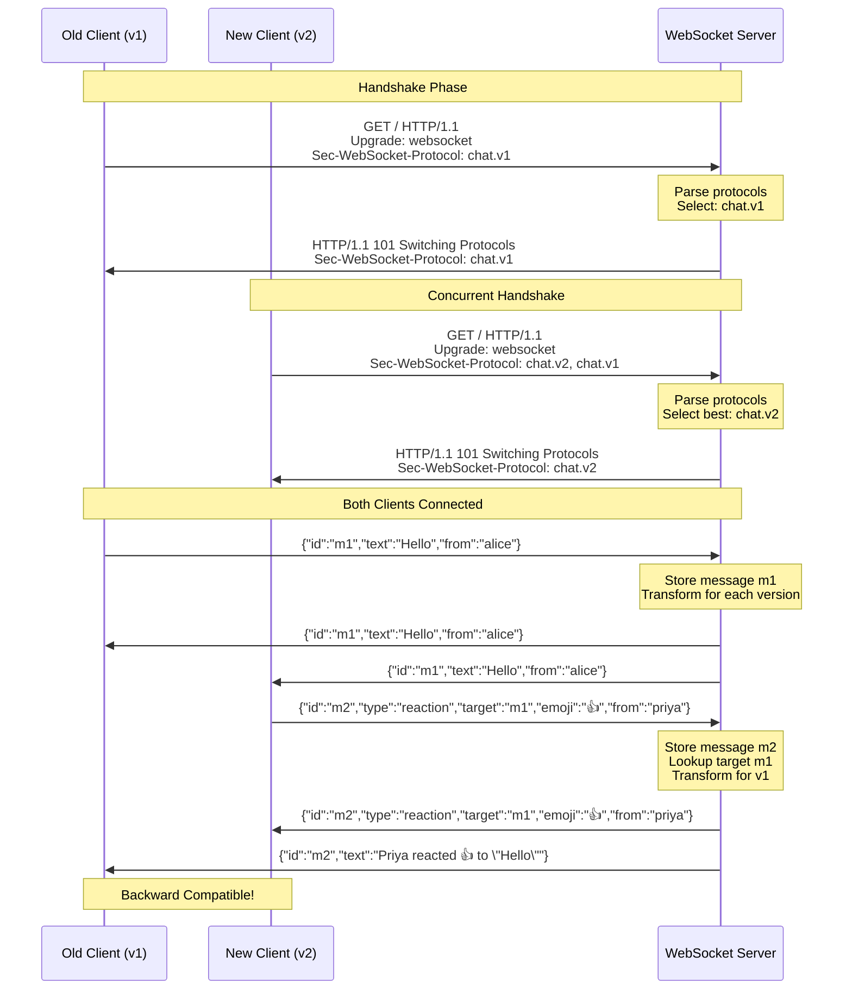

# WebSocket Chat Application with Protocol Versioning

A demonstration of WebSocket protocol versioning using the `Sec-WebSocket-Protocol` header. This application showcases how to maintain backward compatibility between different protocol versions while introducing new features.

This project demonstrates a **production-ready approach** to WebSocket protocol versioning using the standard [Sec-WebSocket-Protocol header](https://datatracker.ietf.org/doc/html/rfc6455#section-11.3.4)—maintaining backward compatibility while enabling feature evolution.

**What You'll Learn:**

- ✅ How protocol negotiation prevents breaking changes
- ✅ Server-side message transformation for backward compatibility
- ✅ Performance optimization strategies (transformation caching, parallel broadcasting)
- ✅ Production deployment patterns with rollback plans
- ✅ Real working code you can run and extend

**Time to Complete:** 30 minutes to understand, 10 minutes to run the demo

## 📋 Table of Contents

- [The Breaking Change](#-the-breaking-change-that-cost-millions)
- [Overview](#-overview)
- [Use Case](#-use-case)
- [When to Use Protocol Versioning](#-when-to-use-protocol-versioning-decision-guide)
- [Architecture](#️-architecture)
- [Message Formats](#-message-formats)
- [Installation](#-installation)
- [Quick Start](#-quick-start)
- [Running the Demo](#-running-the-demo)
- [Manual Testing](#-manual-testing)
- [Performance Optimizations](#-performance-optimizations)
- [Production Deployment Guide](#-production-deployment-guide)
- [Security Considerations](#-security-considerations)
- [Extending to New Versions](#-extending-to-new-versions)
- [Technical Details](#-technical-details)
- [Project Structure](#-project-structure)
- [Learning Objectives](#-learning-objectives)
- [References](#-references)
- [Contributing](#-contributing)
- [Troubleshooting](#-troubleshooting)
- [License](#-license)

## 🎯 Overview

This project demonstrates **WebSocket protocol versioning** through a practical chat application that supports two protocol versions:

- **chat.v1** - Basic text messages only
- **chat.v2** - Structured messages with reactions support

The server automatically negotiates protocol versions with clients during the WebSocket handshake and transforms messages appropriately for each client based on their supported version.

### Key Features

✅ Protocol negotiation via `Sec-WebSocket-Protocol` header  
✅ Server-side message transformation for backward compatibility  
✅ Extensible architecture for adding new protocol versions  
✅ Complete demo showcasing version negotiation and message transformation  
✅ Interactive clients for manual testing  

## 💡 Use Case

### Why Version WebSocket Protocols?

In real-world applications, APIs evolve over time. WebSocket-based applications face unique challenges:

1. **Long-lived connections** - Unlike HTTP REST APIs where clients make discrete requests, WebSocket connections can remain open for extended periods
2. **Gradual rollouts** - Not all clients can be updated simultaneously
3. **Multiple client versions** - Mobile apps, web clients, and IoT devices may update at different rates
4. **Feature additions** - New message types and capabilities need to be introduced without breaking existing clients

### Solution: Protocol Versioning

By using the `Sec-WebSocket-Protocol` header:

1. Clients declare which versions they support during the handshake
2. Server selects the best mutually supported version
3. Server transforms messages appropriately for each client's version
4. Old and new clients can coexist seamlessly

## 🤔 When to Use Protocol Versioning: Decision Guide

Not every WebSocket change requires versioning. Use this decision tree to determine your strategy:

```
                    Need to change WebSocket protocol?
                              |
              ┌───────────────┴────────────────┐
              |                                |
        Breaking change?                 Additive only?
              |                                |
        ┌─────┴─────┐                    Use versioning
        |           |                    (backward compatible)
    Can force    Can't force                  |
    all clients?  all clients?                |
        |           |                         ↓
        ↓           ↓                    Add new message types
    Deploy      Use protocol            Old clients ignore
    all at once  versioning             New clients use them
```

**Use Protocol Versioning When:**

- ✅ Changing existing message structure (breaking change)
- ✅ Multiple client types (web, mobile, IoT) with different update schedules
- ✅ App store review delays for mobile clients
- ✅ Need graceful migration period (weeks/months)
- ✅ Can't coordinate simultaneous server + client deployments

**Don't Need Versioning When:**

- ❌ Only adding new optional fields (clients can ignore)
- ❌ All clients under your control (same deployment)
- ❌ Can force immediate updates (internal tools)
- ❌ WebSocket only used for notifications (no complex protocol)

**Further Reading:**

- [API Evolution Strategies](https://www.ics.uci.edu/~fielding/pubs/dissertation/rest_arch_style.htm) - Roy Fielding's dissertation on REST constraints
- [WebSocket API Specification](https://websockets.spec.whatwg.org/) - WHATWG Living Standard
- [Protocol Versioning Best Practices](https://www.ietf.org/archive/id/draft-ietf-httpbis-semantics-19.html#name-protocol-versioning) - IETF HTTP Semantics

## 🏗️ Architecture

### System Overview

```
┌─────────────────────────────────────────────────────────────┐
│                      WebSocket Server                        │
│  ┌────────────────────────────────────────────────────────┐ │
│  │  Protocol Negotiation (Sec-WebSocket-Protocol header)  │ │
│  └────────────────────────────────────────────────────────┘ │
│  ┌────────────────────────────────────────────────────────┐ │
│  │  Message Store (for reaction target lookup)            │ │
│  └────────────────────────────────────────────────────────┘ │
│  ┌────────────────────────────────────────────────────────┐ │
│  │  Protocol Handlers (V1, V2, ...)                       │ │
│  │  - Transform messages based on client version          │ │
│  └────────────────────────────────────────────────────────┘ │
└─────────────────────────────────────────────────────────────┘
         │                                     │
         │                                     │
         ▼                                     ▼
┌──────────────────┐              ┌──────────────────────┐
│  Old Client      │              │  New Client          │
│  (chat.v1)       │              │  (chat.v2, chat.v1)  │
├──────────────────┤              ├──────────────────────┤
│ Handshake:       │              │ Handshake:           │
│ "chat.v1"        │              │ "chat.v2, chat.v1"   │
│                  │              │                      │
│ Negotiated:      │              │ Negotiated:          │
│ "chat.v1"        │              │ "chat.v2"            │
│                  │              │                      │
│ Receives:        │              │ Receives:            │
│ Text messages    │              │ Structured messages  │
│ (reactions as    │              │ (reactions as rich   │
│  text)           │              │  objects)            │
└──────────────────┘              └──────────────────────┘
```

### Protocol Negotiation Flow

```
Client                          Server
  │                               │
  │  WebSocket Upgrade            │
  │  Sec-WebSocket-Protocol:      │
  │  "chat.v2, chat.v1"          │
  ├──────────────────────────────>│
  │                               │ Parse requested protocols
  │                               │ Select highest supported
  │                               │ version: "chat.v2"
  │                               │
  │  101 Switching Protocols      │
  │  Sec-WebSocket-Protocol:      │
  │  "chat.v2"                    │
  │<──────────────────────────────┤
  │                               │
  │  [Connection established]     │
  │  Tagged with protocol: v2     │
```

### Detailed Sequence Diagram

The following diagram shows the complete end-to-end flow of protocol negotiation and message transformation:



**Figure 1:** Complete protocol negotiation and message transformation sequence

**Key Observations:**

1. Protocol negotiation happens once during handshake
2. Each client is tagged with its negotiated version for the connection lifetime
3. Server transforms messages in real-time based on client version
4. v2 clients receive rich structured data, v1 clients receive text descriptions

### Message Transformation Flow

```
New Client (v2)                 Server                 Old Client (v1)
     │                            │                           │
     │  Reaction Message          │                           │
     │  {"type": "reaction",      │                           │
     │   "target": "m17",         │                           │
     │   "emoji": "👍"}           │                           │
     ├───────────────────────────>│                           │
     │                            │                           │
     │                            │ Store message             │
     │                            │                           │
     │                            │ For v2 clients:           │
     │                            │ Pass through unchanged    │
     │<───────────────────────────┤                           │
     │  {"type": "reaction"...}   │                           │
     │                            │                           │
     │                            │ For v1 clients:           │
     │                            │ Transform to text         │
     │                            ├──────────────────────────>│
     │                            │  {"text": "Priya         │
     │                            │   reacted 👍 to          │
     │                            │   \"Lunch?\""}            │
```

## 📦 Message Formats

### Protocol v1 (chat.v1)

**Text Message:**

```json
{
  "id": "m17",
  "text": "Lunch?",
  "from": "alice"
}
```

**Reaction (transformed from v2):**

```json
{
  "id": "m42",
  "text": "Priya reacted 👍 to \"Lunch?\""
}
```

### Protocol v2 (chat.v2)

**Text Message:**

```json
{
  "id": "m17",
  "text": "Lunch?",
  "from": "alice"
}
```

**Reaction (native format):**

```json
{
  "id": "m42",
  "type": "reaction",
  "target": "m17",
  "emoji": "👍",
  "from": "priya"
}
```

### Comparison Table

| Feature | v1 (chat.v1) | v2 (chat.v2) |
|---------|--------------|--------------|
| Text messages | ✅ Supported | ✅ Supported |
| Reactions | ❌ Not supported (transformed to text) | ✅ Native support |
| Message structure | Simple flat objects | Rich structured objects |
| Extensibility | Limited | High |

## 🚀 Installation

### Prerequisites

- [Python 3.7 or higher](https://www.python.org/downloads/)
- pip (Python package installer)

### Setup Steps

1. **Clone or download this repository:**
   ```bash
    cd websocket-chat-app
   ```
2. **Create a virtual environment:**
   ```bash
    python -m venv .venv
   ```
3. **Activate the virtual environment:**

   On **macOS/Linux**:

    On **Windows**:
4. **Install dependencies:**
   ```bash
    .venv/bin/pip install -r requirements.txt
   ```

    This installs the [`websockets`](https://pypi.org/project/websockets/) library (version 12.0 or higher).
5. **Verify installation:**
   ```bash
    .venv/bin/python --version  # Should be 3.7+
    .venv/bin/python -c "import websockets; print(websockets.__version__)"
   ```

**Note:** Remember to activate the virtual environment (step 3) whenever you work on this project. To deactivate the virtual environment when done, simply run:

```bash
deactivate
```

## 🎬 Quick Start

The fastest way to see the protocol versioning in action:

**Note:** Ensure your virtual environment is activated before running the demo (see Setup Steps above).

```bash
.venv/bin/python demo.py
```

This runs an **automated demonstration** that:

1. Starts a WebSocket server
2. Connects an old client (Alice, chat.v1)
3. Connects a new client (Priya, chat.v2)
4. Exchanges messages and reactions
5. Shows how messages are transformed for each client
6. Gracefully shuts down

**Expected output:**

```
======================================================================
🎭 WebSocket Protocol Versioning Demo
======================================================================

This demo will showcase:
  • Protocol negotiation via Sec-WebSocket-Protocol header
  • Version-aware message transformation
  • Backward compatibility between chat.v1 and chat.v2

======================================================================

======================================================================
🚀 STEP 1: Starting WebSocket Chat Server
======================================================================
✅ Server started on ws://localhost:8765
   Supported protocols: chat.v2, chat.v1

======================================================================
🔗 STEP 2: Connecting Clients
======================================================================

📱 Connecting OLD CLIENT (Alice) with chat.v1...
   ✅ Alice connected with protocol: chat.v1

📱 Connecting NEW CLIENT (Priya) with chat.v2, chat.v1...
   ✅ Priya connected with protocol: chat.v2

======================================================================
💬 STEP 3: Message Exchange Demo
======================================================================

📤 [Alice] Sending text message...
   Message: {"id": "m17", "text": "Lunch?", "from": "alice"}

📥 Both clients receive the text message
   (Check logs above for actual receipts)

📤 [Priya] Sending reaction to Alice's message...
   Reaction: {"id": "m42", "type": "reaction", "target": "m17", "emoji": "👍", "from": "priya"}

📥 Message Transformation Demo:
   ➡️  Alice (v1) receives: Transformed to text description
       {"id": "m42", "text": "Priya reacted 👍 to \"Lunch?\""}

   ➡️  Priya (v2) receives: Original structured format
       {"id": "m42", "type": "reaction", "target": "m17", "emoji": "👍", "from": "priya"}

   (Check logs above for actual receipts)

======================================================================
✨ DEMO COMPLETE!
======================================================================

📋 Summary:
   ✅ Server started with protocol negotiation
   ✅ Old client (Alice) connected with chat.v1
   ✅ New client (Priya) connected with chat.v2
   ✅ Text message broadcast to both clients
   ✅ Reaction transformed for v1, preserved for v2

🎯 Key Takeaway:
   The server successfully negotiated different protocol versions
   and transformed messages appropriately for each client!
======================================================================
```

## 🧪 Running the Demo

### Automated Demo

Run the complete automated demonstration:

```bash
.venv/bin/python demo.py
```

### Manual Testing Instructions

For hands-on testing with multiple terminals:

```bash
.venv/bin/python demo.py --manual
```

This displays step-by-step instructions for manual testing.

## 🔧 Manual Testing

To understand the system deeply, run each component separately:

**Note:** Ensure your virtual environment is activated before running any commands (see Setup Steps above).

### Terminal 1: Start the Server

```bash
.venv/bin/python server.py
```

You should see:

```
🚀 WebSocket Chat Server started on ws://localhost:8765
   Supported protocols: chat.v2, chat.v1
```

### Terminal 2: Start Old Client (v1)

```bash
.venv/bin/python client_old.py --username alice --interactive
```

You should see:

```
🔗 Connecting to ws://localhost:8765 as alice...
   Requesting protocol: chat.v1
✅ Connected! Protocol negotiated: chat.v1

============================================================
💬 Chat Client v1 - Connected as alice
   Protocol: chat.v1
============================================================
Type your messages (or 'quit' to exit):

alice>
```

### Terminal 3: Start New Client (v2)

```bash
.venv/bin/python client_new.py --username priya --interactive
```

You should see:

```
🔗 Connecting to ws://localhost:8765 as priya...
   Requesting protocols: chat.v2, chat.v1
✅ Connected! Protocol negotiated: chat.v2

============================================================
💬 Chat Client v2 - Connected as priya
   Protocol: chat.v2
============================================================
Commands:
  - Type a message to send text
  - /react <msg_id> <emoji> to send a reaction
  - quit or exit to disconnect
============================================================

priya>
```

### Test Sequence

1. **In Alice's terminal (v1), send a message:**
   ```
    alice> Lunch?
   ```
2. **Both terminals should show the message** being received
3. **In Priya's terminal (v2), send a reaction:**
   ```
    priya> /react m1 👍
   ```
4. **Observe the transformation:**
   - **Alice (v1)** sees: `Priya reacted 👍 to "Lunch?"`
   - **Priya (v2)** sees the structured reaction object
5. **Send more messages** to test the system
6. **Type** `quit` in each terminal to disconnect

### 📚 Further Reading

- [Python asyncio.gather() Documentation](https://docs.python.org/3/library/asyncio-task.html#asyncio.gather) - Concurrent task execution
- [Performance Best Practices for WebSockets](https://websockets.readthedocs.io/en/stable/topics/performance.html) - websockets library guide
- [The C10K Problem](http://www.kegel.com/c10k.html) - Dan Kegel's classic paper on high-concurrency servers

## 🔧 Extending to New Versions

The architecture is designed for easy extension. Here's how to add `chat.v3`:

### Step 1: Create a V3 Handler

Edit `protocol_handlers.py`:

```python
class V3Handler(ProtocolHandler):
    """
    Protocol handler for chat.v3 clients.
    
    V3 adds support for threaded replies.
    """
    
    def get_version(self) -> str:
        return "chat.v3"
    
    def transform_message(self, message: dict, message_store: MessageStore) -> dict:
        # V3 is native format, pass through
        # Or add transformations for older message types
        return message
```

### Step 2: Register the Handler

In `protocol_handlers.py`, update the `HANDLERS` dictionary:

```python
HANDLERS: Dict[str, ProtocolHandler] = {
    "chat.v1": V1Handler(),
    "chat.v2": V2Handler(),
    "chat.v3": V3Handler(),  # Add new version
}
```

### Step 3: Update Supported Versions

In `protocol_handlers.py`, update `get_supported_versions()`:

```python
def get_supported_versions() -> list:
    return ["chat.v3", "chat.v2", "chat.v1"]  # Newest first
```

### Step 4: Create a V3 Client (Optional)

Create `client_v3.py` following the pattern of `client_new.py`, requesting:

```python
subprotocols=["chat.v3", "chat.v2", "chat.v1"]
```

### That's It!

The server will now:

- Negotiate v3 with capable clients
- Fall back to v2 or v1 for older clients
- Transform messages appropriately for each version

## 📁 Project Structure

```
websocket-chat-app/
│
├── README.md                    # This file - complete documentation
├── requirements.txt             # Python dependencies (websockets>=12.0)
│
├── server.py                    # WebSocket server with protocol negotiation
│   ├── ChatServer class         # Main server logic
│   ├── Protocol negotiation     # Handshake handling
│   ├── Client management        # Connection tracking
│   └── Message broadcasting     # Version-aware distribution
│
├── protocol_handlers.py         # Protocol-specific message transformers
│   ├── ProtocolHandler          # Abstract base class
│   ├── V1Handler                # Transforms for chat.v1 clients
│   ├── V2Handler                # Transforms for chat.v2 clients
│   └── HANDLERS registry        # Version lookup
│
├── message_store.py            # In-memory message storage
│   └── MessageStore class       # For reaction target lookup
│
├── client_old.py               # Old client (chat.v1)
│   └── V1ChatClient class       # Text-only protocol
│
├── client_new.py               # New client (chat.v2)
│   └── V2ChatClient class       # Supports reactions
│
└── demo.py                     # Automated demonstration
    └── DemoOrchestrator class   # Coordinates demo sequence
```

### Component Responsibilities

| Component | Responsibility |
|-----------|----------------|
| `server.py` | WebSocket server, protocol negotiation, message routing |
| `protocol_handlers.py` | Message transformation logic per protocol version |
| `message_store.py` | In-memory storage for message lookup |
| `client_old.py` | v1 client implementation (text only) |
| `client_new.py` | v2 client implementation (text + reactions) |
| `demo.py` | Automated demonstration orchestration |

## 📚 References

### Official Specifications

- [RFC 6455 - The WebSocket Protocol](https://datatracker.ietf.org/doc/html/rfc6455) - IETF WebSocket specification
- [WebSocket API - WHATWG Living Standard](https://websockets.spec.whatwg.org/) - Browser WebSocket API
- [HTTP Semantics - Protocol Versioning](https://www.ietf.org/archive/id/draft-ietf-httpbis-semantics-19.html#name-protocol-versioning) - IETF protocol versioning guidance

### Documentation & Libraries

- [Python websockets Library](https://websockets.readthedocs.io/) - Pure Python WebSocket implementation
- [Python asyncio Documentation](https://docs.python.org/3/library/asyncio.html) - Asynchronous I/O
- [Prometheus Client Library](https://github.com/prometheus/client_python) - Metrics and monitoring

### Design Patterns

- [Strategy Pattern](https://refactoring.guru/design-patterns/strategy) - Refactoring Guru
- [REST Architectural Style](https://www.ics.uci.edu/~fielding/pubs/dissertation/rest_arch_style.htm) - Roy Fielding's dissertation

### Performance & Scalability

- [The C10K Problem](http://www.kegel.com/c10k.html) - Dan Kegel on high-concurrency servers
- [Performance Best Practices - websockets](https://websockets.readthedocs.io/en/stable/topics/performance.html)
- [Python asyncio Event Loop](https://docs.python.org/3/library/asyncio-eventloop.html)

### Production & Deployment

- [WebSocket Load Balancing with NGINX](https://www.nginx.com/blog/websocket-nginx/)
- [Kubernetes WebSocket Deployment](https://kubernetes.io/blog/2019/03/15/kubernetes-setup-for-websocket-applications/)
- [Prometheus Monitoring Best Practices](https://prometheus.io/docs/practices/naming/)

### Security

- [OWASP WebSocket Security Cheat Sheet](https://cheatsheetseries.owasp.org/cheatsheets/WebSocket_Security_Cheat_Sheet.html)
- [WebSocket Security Best Practices](https://devcenter.heroku.com/articles/websocket-security)
- [OWASP API Security Top 10](https://owasp.org/www-project-api-security/)

### Related Articles

- [MDN - HTTP Content Negotiation](https://developer.mozilla.org/en-US/docs/Web/HTTP/Content_negotiation)
- [Martin Fowler on API Evolution](https://martinfowler.com/articles/enterpriseREST.html#Versioning)

### Project Files

- [`PERFORMANCE_FIX.md`](PERFORMANCE_FIX.md) - Detailed performance optimization analysis
- [`IMPLEMENTATION_SUMMARY.md`](IMPLEMENTATION_SUMMARY.md) - Implementation overview

## 🤝 Contributing

This is a demonstration project. To extend it:

1. Add new protocol versions (chat.v3, chat.v4, ...)
2. Implement additional message types (threads, edits, deletes, ...)
3. Add authentication and authorization
4. Implement persistence with a database
5. Add comprehensive test suites
6. Deploy to production with Docker/Kubernetes

## 📝 License

This project is provided as-is for educational purposes.

## 🐛 Troubleshooting

### Port Already in Use

If you see `Address already in use` error:

```bash
# Find the process using port 8765
lsof -i :8765

# Kill it (replace PID with actual process ID)
kill -9 <PID>

# Or use a different port
python server.py --port 8766
```

### Connection Refused

Ensure the server is running before starting clients:

1. Start server first: `python server.py`
2. Wait for "Server started" message
3. Then start clients

### Import Errors

Make sure dependencies are installed:

```bash
pip install -r requirements.txt
```

### Python Version

Check Python version:

```bash
python --version  # Should be 3.7 or higher
```

If using Python 3.6 or earlier, upgrade to Python 3.7+.

---

**Built with ❤️ to demonstrate WebSocket protocol versioning**
